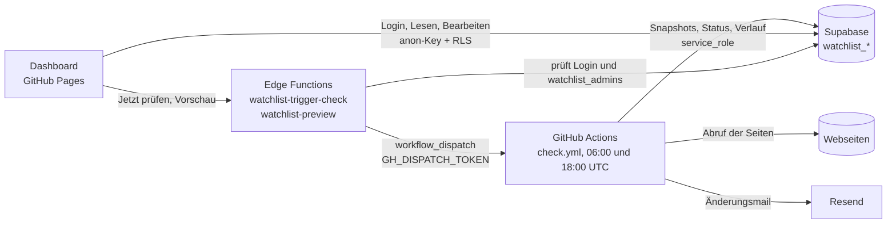

# watchlist

[](https://github.com/jhoelzl/watchlist/actions/workflows/check.yml)
[](https://github.com/jhoelzl/watchlist/actions/workflows/tests.yml)

Prüft die Seiten aus `urls.yml` 2x täglich (GitHub Actions) und schickt bei Änderungen eine gruppierte HTML-Mail mit Diff über Resend.

## Architektur



- Der Prüflauf (`check.py`) ist der einzige Schreiber der Snapshots und des Verlaufs. Er arbeitet mit dem geheimen `service_role`-Key.
- Das Dashboard kennt nur den öffentlichen Anon-Key. Was es sehen und ändern darf, regeln die RLS-Policies in `supabase/schema.sql` (nur Konten aus `watchlist_admins`).
- Die Edge Functions sind die einzige Stelle mit dem GitHub-Token. Sie prüfen Login und Admin selbst, erlauben nur `https://jhoelzl.github.io` als Herkunft und starten höchstens einen Lauf pro Minute.
- Der Zeitplan steht in UTC (`0 6,18 * * *`). In der Sommerzeit (MESZ) kommen die Mails um 08:00 und 20:00, in der Winterzeit um 07:00 und 19:00.

## Einrichtung als Checkliste

- [ ] **Resend:** Account anlegen, Domain verifizieren (oder nur an die eigene Adresse mit `onboarding@resend.dev` senden), API-Key erzeugen.
- [ ] **Supabase-Schema:** [supabase/schema.sql](supabase/schema.sql) im SQL-Editor ausführen, danach das eigene Konto in `watchlist_admins` eintragen (siehe „Dashboard mit Login“).
- [ ] **GitHub-Secrets** (Settings → Secrets and variables → Actions): `SUPABASE_URL`, `SUPABASE_SERVICE_KEY`, `SUPABASE_ANON_KEY`, `RESEND_API_KEY`, `MAIL_TO`, optional `MAIL_FROM`.
- [ ] **Pages:** Settings → Pages → Source „GitHub Actions“, Variable `ENABLE_PAGES=true`. Danach läuft `pages.yml` und veröffentlicht das Dashboard.
- [ ] **Redirect-URL:** In Supabase unter Authentication → URL Configuration die Dashboard-Adresse (`https://jhoelzl.github.io/watchlist/`) als Site URL bzw. erlaubte Redirect-URL eintragen. Sonst führen Links aus Bestätigungs- und Reset-Mails ins Leere.
- [ ] **„Jetzt prüfen“:** Fine-grained Token (nur dieses Repo, „Actions: Read and write“) als `GH_DISPATCH_TOKEN` in den Supabase-Secrets setzen und beide Edge Functions deployen (Befehle im Abschnitt „Dashboard mit Login“).
- [ ] **Erster Lauf:** Actions → check → Run workflow. Er legt die Baselines an und schickt keine Mail.

## Setup (Details)
1. Resend-Account anlegen, Domain verifizieren (oder nur an die eigene Adresse mit `onboarding@resend.dev` senden) und API-Key erzeugen.
2. Repo → Settings → Secrets and variables → Actions → Secrets:
   - `RESEND_API_KEY`
   - `MAIL_TO`
   - `MAIL_FROM` (optional, Standard `onboarding@resend.dev`, sonst z. B. `watchlist@deine-domain.at`)
3. `urls.example.yml` nach `urls.yml` kopieren und pflegen (`urls.yml` ist in `.gitignore`, damit keine persönlichen URLs im Repo landen; mit Supabase pflegst du die URLs im Dashboard), dann Actions → check → Run workflow (erzeugt die Baselines, keine Mail).

## Supabase statt Dateien (URLs, Snapshots, Diffs, Status)

Mit `SUPABASE_URL` und `SUPABASE_SERVICE_KEY` (Umgebungsvariablen bzw. Repo-Secrets) liegen URLs, Snapshots, Fehlerzähler, Status, HTTP-Cache und der Änderungsverlauf (inkl. Diffs) in Supabase-Tabellen mit dem Präfix `watchlist_`. Ohne sie läuft `check.py` lokal im Dateimodus (`urls.yml`, `state/`).

1. Im Supabase SQL-Editor [supabase/schema.sql](supabase/schema.sql) ausführen (RLS ist aktiv, keine öffentlichen Policies).
2. Project Settings → API Keys: **Project URL** als `SUPABASE_URL` und den **service_role**-Key als `SUPABASE_SERVICE_KEY` verwenden. Der Anon-Key reicht nicht, er darf wegen RLS nichts lesen oder schreiben. Der service_role-Key ist geheim (umgeht RLS): nur in `.env` und als Secret, nie im Frontend.
3. Lokal migrieren (einmalig, wiederholbar): `uv run --env-file .env migrate.py --state-dir state` (Ordner mit den bisherigen Snapshots; nicht nötig, wenn du bei null anfängst).
4. Beide Werte als Repo-Secrets eintragen. Der Workflow arbeitet nur noch mit Supabase und kennt `urls.yml` nicht. `urls.yml` ist nicht im Repo.
5. Neue URLs: `uv run --env-file .env add.py <url>` schreibt direkt in `watchlist_urls`. Einträge lassen sich auch im Supabase-Table-Editor pflegen (`options` enthält `selector` (`auto` = Bereich automatisch erkennen), `js`, `ignore`, `only_added`, `interval` (`daily`/`weekly`), `min_ratio`, `ignore_robots`; `active = false` pausiert eine URL; gemeinsame Optionen in `watchlist_settings` unter dem Schlüssel `defaults`).

### Dashboard mit Login (`web/`)

Vite + React + `supabase-js`, Anmeldung per E-Mail und Passwort wie in der App sheet-music (gleiches Supabase-Projekt, gleiche Konten). Es liest Status und Änderungsverlauf direkt aus Supabase. Ohne Anmeldung sieht man nichts.

- Die Registrierung im Projekt ist offen, deshalb schaltet `supabase/schema.sql` nur Konten aus `watchlist_admins` frei (Policies, kein Zugriff auf Snapshots). Nach dem Ausführen des Schemas das eigene Konto freischalten (SQL-Editor): `insert into watchlist_admins (user_id) select id from auth.users where email = 'du@example.com' on conflict do nothing;`. Ein Konto, das noch nicht freigeschaltet ist, sieht „nicht freigeschaltet".
- Lokal: `cd web`, `.env.example` nach `.env` kopieren und `VITE_SUPABASE_URL` sowie `VITE_SUPABASE_ANON_KEY` (Publishable/Anon-Key, **nicht** der Secret-Key) eintragen, dann `npm ci && npm run dev`. Prüfen mit `npm run lint`, `npm test`, `npm run build`.
- GitHub Pages: Secret `SUPABASE_ANON_KEY` (Publishable-Key) anlegen und die Variable `ENABLE_PAGES=true` setzen. Der eigene Workflow `pages.yml` baut dann `web/` und veröffentlicht `web/dist` (bei jedem Push auf `web/**` und manuell). Er ist unabhängig vom Prüflauf. Die Seite ist öffentlich erreichbar, zeigt aber ohne Anmeldung keine Daten. Der statische Export im Dateimodus wird nicht mehr veröffentlicht.
- Tab „Gruppen“: Gruppen anlegen, umbenennen, URLs zuordnen und auflösen. Das ändert `grp` an den URLs und braucht die Policy `admins update urls` aus `supabase/schema.sql` (einmal im SQL-Editor ausführen).
- URLs bearbeiten: Der Stift in der URL-Tabelle öffnet ein Formular für Name, Gruppe, Selector, JavaScript, Prüfintervall, `ignore`, `only_added` und Pausieren. Pausierte URLs werden nicht geprüft und erscheinen als „Pausiert“. Auch das braucht die Policy `admins update urls`.
- Verlauf pro Seite: Der Uhr-Button (⏱) in der URL-Tabelle zeigt nur die Änderungen dieser Seite (bis zu 500 aus der Datenbank).
- Der Filterzustand (Tab, Gruppe, Status, Zeitraum, Suche) steht im URL-Hash, die Ansicht ist teilbar und bleibt beim Neuladen.
- Gruppen-Tab: Reihenfolge, Farbe, Icon, leere Gruppen und Sammelaktion „Alle pausieren/fortsetzen“. Dafür einmal den Block `watchlist_groups` aus `supabase/schema.sql` im SQL-Editor ausführen.
- „Jetzt prüfen“: Der Button ruft die Edge Function `watchlist-trigger-check` (`supabase/functions/`) auf. Sie prüft die Anmeldung und `watchlist_admins` und startet dann den Workflow `check`. Einrichten: Fine-grained Token auf GitHub anlegen (nur dieses Repo, Berechtigung „Actions: Read and write“), dann `supabase secrets set GH_DISPATCH_TOKEN=… --project-ref <ref>` und `supabase functions deploy watchlist-trigger-check --project-ref <ref> --no-verify-jwt`.
- Selector-Vorschau: Im Formular „URL hinzufügen“ ruft die Edge Function `watchlist-preview` die Seite ab und zeigt den erkannten Bereich samt Textmenge. Deployen: `supabase functions deploy watchlist-preview --project-ref <ref> --no-verify-jwt`. Sie prüft wie der Button Anmeldung und `watchlist_admins`, blockt interne Adressen und rendert kein JavaScript.
- Import / Export: Das Menü „Import / Export“ sichert die URL-Liste als YAML oder JSON (Format wie `urls.yml`) und liest solche Dateien wieder ein. Vorhandene URLs bleiben unberührt. Der Import braucht die Insert-Policy `admins add urls`.

Alternativ geht eine direkte Postgres-Verbindung mit `SUPABASE_DB_URL` (Session-Pooler-URL mit Datenbankpasswort), sie hat Vorrang.

Tests gegen echtes Postgres (`tests/test_pgstore.py`) laufen mit `WATCHLIST_TEST_DSN=...` oder mit installiertem `pgserver` (Python 3.12), sonst werden sie übersprungen.

## urls.yml
```yaml
defaults:                      # gilt für alle URLs, ignore-Listen werden zusammengeführt
  ignore: ['Last updated on\s*\S+']

urls:
  - url: https://example.com/releases
    name: "Mein Name"          # optional, sonst der Seitentitel
    group: Azure               # optional, gruppiert Mail und Dashboard
    selector: main             # optional, nur dieser CSS-Bereich; "auto" wählt main/article/[role=main] selbst, sonst ganze Seite
    ignore: ['\d{2}:\d{2}']    # optional, Regex wird vor dem Vergleich entfernt
    only_added: true           # optional, Mail zeigt nur neue Zeilen
    interval: weekly           # optional, daily oder weekly: seltener prüfen (Standard: bei jedem Lauf); Probleme werden trotzdem jedes Mal geprüft
    js: true                   # optional, Seite mit Playwright (Chromium) rendern
    min_ratio: 0.3             # optional, Textwächter (0 = aus), siehe unten
    ignore_robots: true        # optional, robots.txt-Sperre übergehen
  - url: https://example.com/feed.xml   # RSS/Atom wird automatisch erkannt
```
- `ignore`-Regex werden beim Start geprüft: ungültige, über 300 Zeichen lange oder zu Backtracking neigende Muster (verschachtelte Quantifizierer wie `(a+)+`) markieren die URL als „Fehler" (Konfigurationsfehler, nicht abgerufen), der Lauf endet mit Fehler und löst die Alarmmail aus.
- Bei Feeds ist `only_added` standardmäßig an (ein Eintrag pro Zeile, entfernte Einträge lösen keine Mail aus).
- Eine reine Liste von URLs ohne `defaults`/`urls` funktioniert weiterhin.
- `js: true` ist langsamer. Der Workflow installiert Chromium nur, wenn irgendwo `js: true` konfiguriert ist (`check.py --needs-js`).

## URL hinzufügen
```
uv run add.py https://example.com/seite          # fragt Name, Gruppe und Selector ab
uv run add.py https://example.com/seite -y       # Vorschläge ohne Rückfrage übernehmen
uv run add.py <url> --group Azure --selector main --js
```
Das Skript ruft die Seite ab, schlägt einen Selector (`main`, `article`, ...) und die Gruppe vorhandener URLs desselben Hosts vor und hängt den Eintrag an `urls.yml` an (Kommentare bleiben erhalten). Findet es im HTML `<link rel="alternate" type="application/rss+xml">` (oder Atom), werden die Feeds aufgelistet und du wählst einen (`--feed` nimmt den ersten, mit `-y` nur ein Hinweis). Die Baseline entsteht beim nächsten Lauf (`uv run check.py`).

## Sprache
Meldungen, Mails, Kommentare und Doku sind auf Deutsch. Code-Bezeichner (Funktionen, Variablen, Konstanten, Optionsnamen in `urls.yml`) und Commit-Nachrichten sind auf Englisch.

## Rücksicht auf Server und Fehlabrufe
- **Parallele Abrufe:** Die Seiten werden mit bis zu 6 Threads geladen, pro Host höchstens 2 gleichzeitig (`max_workers` in `settings.json`, `MAX_PER_HOST` in `fetch.py`). Seiten mit `js: true` laufen nacheinander. Die Auswertung, Mails und Snapshots bleiben seriell und in der Reihenfolge von `urls.yml`.
- **robots.txt** wird pro Host einmal je Lauf geprüft. Verbietet sie eine URL, zählt das als Abruffehler (Override: `ignore_robots: true`). Fehlt die Datei oder ist sie nicht erreichbar, ist alles erlaubt.
- **ETag / Last-Modified:** Antwortet der Server mit `304 Not Modified`, wird die Seite nicht neu geladen. Die Werte stehen in `state/http.json` (bzw. in Supabase). Ändert sich `selector`, `ignore` oder `js`, wird wieder voll geladen. Nicht alle Server unterstützen das (z. B. Google nur eingeschränkt).
- **Textwächter:** Liefert eine Seite plötzlich unter 30 % des bisherigen Textes (nur bei Snapshots ab 500 Zeichen), gilt das als Fehlabruf (Cookie-Wand, Bot-Block). Der Snapshot bleibt unverändert, es gibt keine Änderungsmail, das Dashboard zeigt „Zu wenig Text", und nach dem 2. Lauf in Folge kommt eine Warnmail. Mit `min_ratio` anpassbar, `0` schaltet den Wächter für diese URL aus.
- **Retry:** Bei Netzwerkfehlern, Timeouts, HTTP 5xx und 429 gibt es bis zu 3 Versuche (Pause 2 s, 5 s, `Retry-After` bis max. 30 s). Andere 4xx werden nicht wiederholt. Erst danach zählt es als Fehlabruf.
- **Fehlerfester Mailversand:** Snapshot und Verlauf einer geänderten Seite werden erst nach erfolgreichem Versand gespeichert. Schlägt Resend fehl, bleibt der alte Snapshot, die Änderung wird im nächsten Lauf erneut erkannt, der Lauf endet mit Fehler (Alarm) und die Seite steht im Dashboard auf „Fehler".
- **only_added:** Für Release-Notes-Seiten mit viel Text empfohlen (in `urls.yml` bereits gesetzt), die Mail zeigt dann nur neue Zeilen.

## Betrieb
- **Badge:** Die Badges oben zeigen den Status des letzten Laufs. Bei einem privaten Repo siehst du sie nur, wenn du bei GitHub eingeloggt bist.
- **Lebenszeichen:** Im ersten Lauf eines neuen Monats kommt eine Mail mit Anzahl der Seiten, Änderungen und Problemen pro Gruppe, den letzten Änderungen und den dauerhaft kaputten Seiten (6 Läufe in Folge, `STUCK_AFTER`) mit Hinweis zur Abhilfe. Bleibt sie aus, läuft der Zeitplan nicht mehr (GitHub deaktiviert ihn nach 60 Tagen ohne Repo-Aktivität).
- **Warnmails mit Tipp:** Die Mails „Probleme beim Abruf" nennen zur Fehlerart eine mögliche Ursache und Abhilfe (robots.txt → `ignore_robots`, 403/Bot-Block/Timeout → `js: true`, 404 → URL prüfen, Selector nicht gefunden usw.).
- **Alarm:** Schlägt der Workflow fehl (z. B. Resend-Fehler), versucht ein letzter Schritt eine Alarmmail mit Link zum Lauf zu senden. Zusätzlich meldet GitHub fehlgeschlagene Läufe selbst per Mail.
- **Diffs:** Gespeichert werden bis zu 500 Diff-Zeilen mit 3 Zeilen Kontext (`store_diff_lines`, `diff_context` in `settings.json`), die Mail zeigt die ersten 60 (`mail_diff_lines`) mit wortgenauer Markierung, `+N −M`, einer Zusammenfassung oben und einem Link „zur geänderten Stelle" (Textfragment `#:~:text=`, funktioniert in Chromium und Safari bei einfachem Text). Der Tab „Letzte Änderungen" im Dashboard zeigt den vollen Diff, gruppiert nach Tag, mit Filter für Zeitraum und Gruppe.
- **Dashboard:** Das Web-Dashboard (`web/`) zeigt Status pro URL, letzte Prüfung und Änderungsverlauf mit Suche und Filtern.
- **Dashboard auf GitHub Pages (optional):** Pages-Seiten sind öffentlich erreichbar, auch bei privatem Repo, und für private Repos braucht es einen bezahlten Plan. Aktivieren: Settings → Pages → Source „GitHub Actions" und Variable `ENABLE_PAGES=true` (Settings → Secrets and variables → Actions → Variables).
- **Dependabot** aktualisiert Abhängigkeiten und Actions wöchentlich, gruppiert in je einen PR pro Ökosystem für Patch- und für Minor-/Major-Updates (Patch-PRs mergt `dependabot-automerge.yml` automatisch, sobald `tests` grün ist), `tests.yml` führt Lint, Typcheck, Tests und `uv audit` (Schwachstellenprüfung der Abhängigkeiten) bei Push, Pull Request und wöchentlich aus.

## Fehlerbehebung

- **„Seite liefert zu wenig Text“ (Status „Zu wenig Text“):** Die Seite lieferte weniger als 30 % des bisherigen Textes, meist wegen Cookie-Wand, Bot-Block oder per JavaScript geladener Inhalte. Der Snapshot bleibt unverändert. `js: true` setzen oder den Selector prüfen. Ist der Rückgang gewollt, `min_ratio` senken (`0` schaltet den Wächter ab).
- **„robots.txt verbietet den Abruf“:** Die Seite will keine automatischen Abrufe. Nur wenn das für dich erlaubt ist, `ignore_robots: true` in den Optionen der URL setzen.
- **„Selector nicht gefunden“:** Die Seite wurde umgebaut oder der Inhalt kommt erst per JavaScript. Im Dashboard unter „Bearbeiten“ die Vorschau nutzen, `selector: auto` probieren oder `js: true` setzen.
- **„Jetzt prüfen“ schlägt fehl:**
  - *„GH_DISPATCH_TOKEN ist nicht gesetzt“*: Das Secret in Supabase fehlt (`supabase secrets set GH_DISPATCH_TOKEN=… --project-ref <ref>`).
  - *Meldung von GitHub (401/403/404)*: Token abgelaufen oder ohne „Actions: Read and write“ für dieses Repo. Neues Token anlegen und das Secret ersetzen.
  - *429*: Der letzte Lauf wurde vor weniger als einer Minute gestartet, kurz warten.
  - *403 oder CORS-Fehler im Browser*: Die Function erlaubt nur `https://jhoelzl.github.io` (und `http://localhost:5173`). Eine andere Adresse muss in `ALLOWED_ORIGINS` der Function ergänzt und neu deployt werden.
  - *„nicht freigeschaltet“*: Das Konto steht nicht in `watchlist_admins`.
- **Änderungen lassen sich nicht speichern („Fehlt die Policy …“):** Die Policies `admins update urls`, `admins add urls` bzw. der Block `watchlist_groups` aus `supabase/schema.sql` wurden noch nicht im SQL-Editor ausgeführt.
- **Immer wieder Änderungen durch Zähler oder Datum:** Im Bearbeiten-Formular erscheinen Ignore-Vorschläge aus dem Verlauf, die sich mit einem Klick übernehmen lassen.

## Lokal
Mitarbeit, Stil und Prüfungen vor dem Commit: [CONTRIBUTING.md](CONTRIBUTING.md).

```
uv run check.py                       # Mails werden nur ausgegeben, wenn RESEND_API_KEY fehlt
uv run --extra js playwright install chromium   # einmalig, nur für js: true (ein Browser pro Lauf, eine Seite je URL)
uv run --extra js check.py            # mit js: true
uv run pytest                         # Tests
uv run ruff check .                   # Lint
uv run ruff format .                  # Formatieren (CI prüft mit --check)
uv run mypy check.py add.py  # Typcheck
uv run pre-commit install             # einmalig pro Klon: gitleaks, ruff, mypy, bei Änderungen in web/ auch oxlint und tsc
uv run pre-commit run --all-files     # alle Hooks von Hand
uv audit --preview-features audit-command  # bekannte Schwachstellen in Abhängigkeiten
```
Mit Secrets aus einer `.env`-Datei: `set -a; source .env; set +a; uv run check.py`.
Falls eine globale uv-Konfiguration mit privaten Index-Feeds stört: `UV_NO_CONFIG=1 uv ...` (nötig z. B. bei `uv add`, damit `uv.lock` nur öffentliche PyPI-URLs enthält).

Abhängigkeiten ändern: `uv add <paket>` (aktualisiert `pyproject.toml` und `uv.lock`).

Optional: `DASHBOARD_URL` (Standard `https://jhoelzl.github.io/watchlist/`) bestimmt, worauf die Dashboard-Links in den Mails zeigen.
