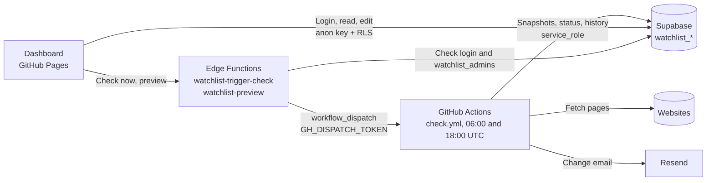

# watchlist

[](https://github.com/jhoelzl/watchlist/actions/workflows/check.yml)
[](https://github.com/jhoelzl/watchlist/actions/workflows/tests.yml)

Checks the pages in `urls.yml` twice daily (GitHub Actions) and sends a grouped HTML email with a diff through Resend when changes are detected.

## Architecture



- The check run (`check.py`) is the only writer of snapshots and history. It uses the secret `service_role` key.
- The dashboard only knows the public anon key. RLS policies in `supabase/schema.sql` control what it can view and change (admin accounts in `watchlist_admins` only).
- The Edge Functions are the only place that holds the GitHub token. They validate login and admin access, allow only `https://jhoelzl.github.io` as an origin, and start at most one run per minute.
- The schedule is in UTC (`0 6,18 * * *`). During daylight saving time (CEST), emails arrive at 08:00 and 20:00; during standard time, at 07:00 and 19:00.

## Setup checklist

- [ ] **Resend:** Create an account, verify a domain (or send only to your own address using `onboarding@resend.dev`), and create an API key.
- [ ] **Supabase schema:** Run [supabase/schema.sql](supabase/schema.sql) in the SQL Editor, then add your account to `watchlist_admins` (see “Dashboard login”).
- [ ] **Secrets:** Supabase credentials are stored in the `watchlist` 1Password vault (the `Supabase` item with the `url`, `anon-key`, and `service-token` fields). In GitHub (Settings → Secrets and variables → Actions), only `OP_SERVICE_ACCOUNT_TOKEN` is stored: a service account with read access to that vault. Workflows load the values through `1password/load-secrets-action` (`op://watchlist/Supabase/url`, etc.). Locally, `op run --env-file=.env -- …` reads the same references. These remain GitHub secrets: `RESEND_API_KEY`, `MAIL_TO`, and optionally `MAIL_FROM`.
- [ ] **Pages:** Set Settings → Pages → Source to “GitHub Actions” and set the `ENABLE_PAGES=true` variable. The `pages.yml` workflow will then publish the dashboard.
- [ ] **Redirect URL:** In Supabase, under Authentication → URL Configuration, add the dashboard address (`https://jhoelzl.github.io/watchlist/`) as the Site URL or an allowed redirect URL. Otherwise, links in confirmation and reset emails will not work.
- [ ] **Check now:** Create a fine-grained token (this repository only, “Actions: Read and write”) and set it as `GH_DISPATCH_TOKEN` in Supabase Secrets, then deploy both Edge Functions (commands in “Dashboard login”).
- [ ] **First run:** Actions → check → Run workflow. It creates the baselines and sends no email.

## Setup (details)
1. Create a Resend account, verify a domain (or send only to your own address using `onboarding@resend.dev`), and create an API key.
2. Repo → Settings → Secrets and variables → Actions → Secrets:
   - `RESEND_API_KEY`
   - `MAIL_TO`
   - `MAIL_FROM` (optional, default `onboarding@resend.dev`, or for example `watchlist@your-domain.at`)
3. Copy `urls.example.yml` to `urls.yml` and edit it (`urls.yml` is in `.gitignore` so personal URLs are not committed; when using Supabase, manage URLs in the dashboard), then run Actions → check → Run workflow (creates baselines, no email).

## Supabase instead of files (URLs, snapshots, diffs, status)

With `SUPABASE_URL` and `SUPABASE_SERVICE_KEY` (environment variables or repository secrets), URLs, snapshots, failure counters, status, HTTP cache, and change history (including diffs) are stored in Supabase tables prefixed with `watchlist_`. Without them, `check.py` runs locally in file mode (`urls.yml`, `state/`).

1. Run [supabase/schema.sql](supabase/schema.sql) in the Supabase SQL Editor (RLS is enabled, with no public policies).
2. Project Settings → API Keys: use the **Project URL** as `SUPABASE_URL` and the **service_role** key as `SUPABASE_SERVICE_KEY`. The anon key is insufficient because RLS prevents it from reading or writing. The service_role key is secret (it bypasses RLS): keep it only in `.env` and as a secret, never in the frontend.
3. Migrate locally (once; safe to repeat): `op run --env-file=.env -- uv run migrate.py --state-dir state` (the folder containing existing snapshots; not needed when starting from scratch).
4. Add both values as repository secrets. The workflow now uses only Supabase and does not access `urls.yml`. `urls.yml` is not in the repository.
5. New URLs: `op run --env-file=.env -- uv run add.py <url>` writes directly to `watchlist_urls`. You can also manage entries in the Supabase Table Editor (`options` includes `selector` (`auto` = detect the area automatically), `js`, `ignore`, `only_added`, `interval` (`daily`/`weekly`), `min_ratio`, and `ignore_robots`; `active = false` pauses a URL; shared options go in `watchlist_settings` under the `defaults` key). The default group is `General`.

### Dashboard login (`web/`)

Vite + React + `supabase-js`, with email-and-password authentication as in the sheet-music app (same Supabase project and accounts). It reads status and change history directly from Supabase. Nothing is visible without signing in.

- Registration is open in the project, so `supabase/schema.sql` grants access only to accounts in `watchlist_admins` (policies; no access to snapshots). After running the schema, authorize your own account in the SQL Editor: `insert into watchlist_admins (user_id) select id from auth.users where email = 'you@example.com' on conflict do nothing;`. An account that has not been authorized sees “Not authorized”.
- To verify the policies, run [supabase/verify_dashboard_permissions.sql](supabase/verify_dashboard_permissions.sql) in the Supabase SQL Editor after adding an admin account. It simulates anonymous, non-admin, and authorized roles with temporary fixtures and rolls the transaction back.
- Locally: run `cd web`, copy `.env.example` to `.env`, and set `VITE_SUPABASE_URL` and `VITE_SUPABASE_ANON_KEY` (the Publishable/Anon key, **not** the Secret key), then run `npm ci && npm run dev`. Validate with `npm run lint`, `npm test`, and `npm run build`.
- GitHub Pages: create the `SUPABASE_ANON_KEY` secret (Publishable key) and set `ENABLE_PAGES=true`. The `pages.yml` workflow builds `web/` and publishes `web/dist` (on every push to `web/**` and manually). It is independent of the check run. The page is publicly accessible but shows no data without login. The static export in file mode is no longer published.
- **Groups tab:** Create and rename groups, assign URLs, and dissolve groups. This updates `grp` on the URLs and requires the `admins update urls` policy from `supabase/schema.sql` (run it once in the SQL Editor).
- **Toasts:** Deleting URLs, importing, and dissolving groups no longer prompt for confirmation; instead, a toast appears in the lower-right corner with “Undo” (8 seconds). Errors also appear there instead of in browser dialogs.
- **Edit URLs:** The pencil in the URL table opens a form for the name, group, selector, JavaScript, check interval, `ignore`, `only_added`, and pausing. Paused URLs are not checked and show as “Paused”. This also requires the `admins update urls` policy.
- **Per-page history:** The clock button (⏱) in the URL table shows changes for that page only (up to 500 from the database).
- The filter state (tab, group, status, date range, search) is stored in the URL hash, so the view can be shared and is preserved on reload.
- **Groups tab:** Configure order, color, icon, empty groups, and the bulk action “Pause/resume all”. Run the `watchlist_groups` block from `supabase/schema.sql` once in the SQL Editor.
- **Check now:** The button calls the `watchlist-trigger-check` Edge Function (`supabase/functions/`). It checks login and `watchlist_admins`, then starts the `check` workflow. The ↻ icon on a row checks only that URL (workflow input `url`, exposed in `check.py` as `WATCHLIST_ONLY_URL`; the ↻ icon in a group header checks the whole group via input `group` / `WATCHLIST_ONLY_GROUP`, where `General` means URLs without a group; the interval is ignored, and other URLs, heartbeats, and run history remain untouched). The Function must be redeployed for this. Setup: create a fine-grained GitHub token (this repository only, “Actions: Read and write”), then run `supabase secrets set GH_DISPATCH_TOKEN=… --project-ref <ref>` and `supabase functions deploy watchlist-trigger-check --project-ref <ref> --no-verify-jwt`.
- **Selector preview:** In the “Add URL” form, the `watchlist-preview` Edge Function fetches the page and shows the detected area and text size. Deploy it with `supabase functions deploy watchlist-preview --project-ref <ref> --no-verify-jwt`. Like the button, it checks login and `watchlist_admins`, blocks internal addresses, and does not render JavaScript.
- **Import / Export:** The “Import / Export” menu saves the URL list as YAML or JSON (same format as `urls.yml`) and imports those files. Existing URLs remain untouched. Import requires the `admins add urls` insert policy.

A direct Postgres connection using `SUPABASE_DB_URL` (Session Pooler URL with database password) is also supported and takes precedence.

Tests against real Postgres (`tests/test_pgstore.py`) run with `WATCHLIST_TEST_DSN=...` or with `pgserver` installed (Python 3.12); otherwise, they are skipped.

## urls.yml
```yaml
defaults:                      # applies to all URLs; ignore lists are merged
  ignore: ['Last updated on\s*\S+']

urls:
  - url: https://example.com/releases
    name: "My name"            # optional, otherwise the page title
    group: Azure               # optional, groups email and dashboard views
    selector: main             # optional, this CSS area only; "auto" chooses main/article/[role=main], otherwise the whole page
    ignore: ['\d{2}:\d{2}']    # optional, regex removed before comparison
    only_added: true           # optional, email shows only new lines
    interval: weekly           # optional, daily or weekly: check less often (default: every run); failures are still checked every time
    js: true                   # optional, render page with Playwright (Chromium)
    screenshot: true           # optional, keep before/after screenshots of changes (needs Chromium)
    min_ratio: 0.3             # optional, text guard (0 = off), see below
    ignore_robots: true        # optional, bypass robots.txt blocking
  - url: https://example.com/feed.xml   # RSS/Atom is detected automatically
```
- `ignore` regexes are validated at startup: invalid patterns, patterns over 300 characters, or patterns prone to backtracking (nested quantifiers such as `(a+)+`) mark the URL as “Error” (configuration error; not fetched), fail the run, and trigger the alert email. In addition, each pattern runs with the `regex` library and a 2-second timeout per page; if exceeded, the URL is a fetch failure (`ignore_timeout`) with a tip in the email.
- For feeds, `only_added` is enabled by default (one entry per line; removed entries do not trigger an email).
- A plain list of URLs without `defaults`/`urls` still works.
- `js: true` is slower. The workflow installs Chromium only if `js: true` is configured somewhere (`check.py --needs-js`).
- `screenshot: true` takes a full-page JPEG (1280 px wide, cut off at 3000 px) when the page is new or its change was saved, and keeps the previous one as "before". Both images are stored per URL (table `watchlist_screenshots`, run `supabase/schema.sql` again; files `state/<key>.before.jpg`/`.after.jpg` without a database). The dashboard shows them side by side under the latest change of that page (**Compare screenshots**). Failures are logged and never fail the run.

## Add a URL
```
uv run add.py https://example.com/seite          # prompts for name, group, and selector
uv run add.py https://example.com/seite -y       # accept suggestions without prompting
uv run add.py <url> --group Azure --selector main --js
```
The script fetches the page, suggests a selector (`main`, `article`, ...) and the group used by existing URLs on the same host, then appends the entry to `urls.yml` (preserving comments). If it finds `<link rel="alternate" type="application/rss+xml">` (or Atom) in the HTML, it lists the feeds and lets you choose one (`--feed` takes the first; with `-y`, it only shows a hint). The baseline is created on the next run (`uv run check.py`).

## Language
Messages, emails, comments, and documentation are in English. Code identifiers (functions, variables, constants, and option names in `urls.yml`) and commit messages are also in English.

## Be considerate of servers and failed fetches
- **Parallel fetches:** Pages are fetched with up to 6 threads, with at most 2 per host (`max_workers` in `settings.json`, `MAX_PER_HOST` in `fetch.py`). Pages with `js: true` run sequentially. Processing, emails, and snapshots remain serial and follow the order in `urls.yml`.
- **URL safety (SSRF):** Only `http`/`https` URLs are fetched. Hosts that are or resolve to non-public addresses (localhost, private networks, link-local such as `169.254.169.254`, `.local`/`.internal`) are rejected, and every redirect target is checked again (max. 5 redirects). With `js: true`, page navigations to internal addresses are aborted. The result is a fetch error with code `blocked_url`. The Edge Function `watchlist-preview` applies the same rules.
- **robots.txt** is checked once per host per run. If it disallows a URL, that counts as a fetch failure (override: `ignore_robots: true`). If the file is missing or unavailable, everything is allowed.
- **ETag / Last-Modified:** If a server responds with `304 Not Modified`, the page is not fetched again. Values are stored in `state/http.json` (or in Supabase). If `selector`, `ignore`, or `js` changes, a full fetch is performed again. Not all servers support this (for example, Google has limited support).
- **Text guard:** If a page suddenly returns less than 30% of its previous text (only for snapshots of at least 500 characters), it counts as a failed fetch (cookie wall, bot block). The snapshot remains unchanged, no change email is sent, the dashboard shows “Too little text”, and a warning email is sent after two consecutive runs. Adjust with `min_ratio`; `0` disables the guard for that URL.
- **Retries:** Network errors, timeouts, HTTP 5xx, and 429 receive up to 3 attempts (delays of 2 s, 5 s, and `Retry-After` up to 30 s). Other 4xx errors are not retried. Only then is it counted as a fetch failure.
- **Failure-safe email delivery:** The snapshot and history for a changed page are saved only after successful delivery. If Resend fails, the old snapshot remains, the change is detected again on the next run, the run fails (alert), and the page shows “Error” in the dashboard.
- **only_added:** Recommended for release notes pages with lots of text (already set in `urls.yml`); email then shows only new lines.

## Operations
- **Badge:** The badges above show the status of the latest run. For a private repository, you can see them only when signed in to GitHub.
- **Heartbeat:** The first run of each new month sends an email with the number of pages, changes, and issues per group, recent changes, and pages that have been consistently failing (6 consecutive runs, `STUCK_AFTER`) with a suggested remedy. If it does not arrive, the schedule is no longer running (GitHub disables it after 60 days without repository activity).
- **Noise learning:** Pages whose changes keep differing only in numbers or ids (timestamps, visitor counters, build hashes) get a yellow “Noisy: N ignore suggestions” badge in the URLs tab. Click it to open the editor, where each suggested `ignore` regex can be applied individually or all at once (“Apply all”). Suggestions come from the latest changes loaded in the dashboard and skip lines your `ignore` patterns already cover.
- **AI summaries (optional):** With `WATCHLIST_SUMMARIES=true`, every saved change gets a one-line “what changed” (e.g. “Pricing table updated, new model added”) from a small LLM. It appears above the diff in the email and under the title in the Recent changes tab (column `watchlist_history.summary`, run `supabase/schema.sql` again). By default it uses GitHub Models (`openai/gpt-4o-mini`) with the workflow's `GITHUB_TOKEN` (`models: read`), so no extra secret is needed; set the repository variable `WATCHLIST_SUMMARIES` to `true` to turn it on. Any OpenAI-compatible endpoint works through `LLM_BASE_URL`, `LLM_API_KEY`, and `LLM_MODEL`. Cost control: only changed pages are sent, input is cut at 3000 characters, output at 60 tokens, and `LLM_MAX_PER_RUN` (default 20) caps the calls per run. Set `summary: false` on a URL to opt out (page text is sent to the provider). Errors and timeouts are logged and the email goes out with the raw diff.
- **Auto-diagnosis:** When a URL fails twice in a row, `diagnose.py` probes likely causes once and stores a suggestion with the status: a moved page (redirect target, https/www/trailing-slash variants answer with 200 → new URL), a redirect loop, bot block (403), too little text or timeout that a browser fixes (`js: true`), robots.txt (`ignore_robots`), or a selector that `selector: auto` still finds. The URLs tab shows it with a one-click button that updates the entry; the warning email repeats it as “Suggested fix”. The `js` probe needs Chromium, so it only works when it is installed (any URL with `js: true` or `screenshot: true` triggers the install in the workflow). A moved URL starts with a new baseline.
- **Warning emails with tips:** “Fetch problem” emails give a possible cause and fix for each error type (robots.txt → `ignore_robots`, 403/bot block/timeout → `js: true`, 404 → check the URL, selector not found, etc.).
- **Alert:** If the workflow fails (for example, a Resend error), a final step attempts to send an alert email with a link to the run. GitHub also emails you about failed runs.
- **Diffs:** Up to 500 diff lines with 3 context lines are stored (`store_diff_lines`, `diff_context` in `settings.json`). The email shows the first 60 (`mail_diff_lines`) with word-level highlighting, `+N −M`, a summary at the top, and a link to “the changed section” (text fragment `#:~:text=`, works in Chromium and Safari for plain text). The dashboard’s “Recent changes” tab shows a calendar heatmap for the last 26 weeks at the top (click a day to filter the list; it follows group and page filters), followed by the full diff grouped by day, with date-range and group filters.
- **Dashboard:** The web dashboard (`web/`) shows status per URL, the last check, and change history with search and filters.
- **GitHub Pages dashboard (optional):** Pages sites are publicly accessible, even for private repositories, and private repositories require a paid plan. Enable it: Settings → Pages → Source “GitHub Actions” and set `ENABLE_PAGES=true` (Settings → Secrets and variables → Actions → Variables).
- **Dependabot** updates dependencies and Actions weekly, grouped into one PR per ecosystem for patch and minor/major updates (patch PRs are automatically merged by `dependabot-automerge.yml` when `tests` passes). `tests.yml` runs lint, type checks, tests, and `uv audit` (dependency vulnerability checks) on pushes, pull requests, and weekly.

## Troubleshooting

- **“Too little text” (status “Too little text”):** The page returned less than 30% of its previous text, usually due to a cookie wall, bot block, or JavaScript-loaded content. The snapshot remains unchanged. Set `js: true` or check the selector. If the decrease is expected, lower `min_ratio` (`0` disables the guard).
- **“robots.txt disallows fetching”:** The site does not allow automated fetches. Set `ignore_robots: true` in the URL options only if you are allowed to do so.
- **“Selector not found”:** The site may have changed, or the content may load only through JavaScript. In the dashboard, use the preview under “Edit”, try `selector: auto`, or set `js: true`.
- **“Check now” fails:**
  - *“GH_DISPATCH_TOKEN is not set”*: The secret is missing in Supabase (`supabase secrets set GH_DISPATCH_TOKEN=… --project-ref <ref>`).
  - *GitHub message (401/403/404)*: The token expired or lacks “Actions: Read and write” for this repository. Create a new token and replace the secret.
  - *429*: The last run started less than a minute ago; wait briefly.
  - *403 or CORS error in the browser*: The Function allows only `https://jhoelzl.github.io` (and `http://localhost:5173`). Add other addresses to `ALLOWED_ORIGINS` in the Function and redeploy it.
  - *“Not authorized”*: The account is not in `watchlist_admins`.
- **Changes cannot be saved (“Missing policy …”):** The `admins update urls` or `admins add urls` policies, or the `watchlist_groups` block from `supabase/schema.sql`, have not yet been run in the SQL Editor.
- **Repeated changes from counters or dates:** The Edit form shows ignore suggestions from history that can be applied with one click.

## Local use
Contributing, style, and pre-commit checks: [CONTRIBUTING.md](CONTRIBUTING.md).

```
uv run check.py                       # emails are only printed when RESEND_API_KEY is missing
uv run --extra js playwright install chromium   # once; only for js: true (one browser per run, one page per URL)
uv run --extra js check.py            # with js: true
uv run pytest                         # tests
uv run ruff check .                   # lint
uv run ruff format .                  # format (CI checks with --check)
uv run mypy check.py add.py           # type check
uv run pre-commit install             # once per clone: gitleaks, ruff, mypy, plus oxlint and tsc for web/ changes
uv run pre-commit run --all-files     # run all hooks manually
uv audit --preview-features audit-command  # known dependency vulnerabilities
```
With secrets from a `.env` file: `op run --env-file=.env -- uv run check.py` (`.env` contains only `op://` references, no values).
If a global uv configuration with private index feeds causes issues: `UV_NO_CONFIG=1 uv ...` (needed, for example, with `uv add`, so `uv.lock` contains only public PyPI URLs).

Change dependencies with `uv add <package>` (updates `pyproject.toml` and `uv.lock`).

Optional: `DASHBOARD_URL` (default `https://jhoelzl.github.io/watchlist/`) determines where dashboard links in emails point.
